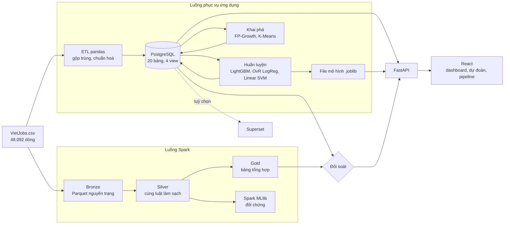

# Kiến trúc hệ thống

## 1. Tổng quan

Hệ thống nhận một bộ dữ liệu tin tuyển dụng dạng file, xử lý theo lô (batch), rồi phục vụ kết quả qua web. Dữ liệu đi qua **hai đường độc lập**: đường pandas nạp PostgreSQL để phục vụ ứng dụng, và đường Spark ghi Parquet. Hai đường dùng cùng luật làm sạch và được đối soát với nhau.



## 2. Luồng xử lý

| Giai đoạn | Thành phần | Đầu vào | Đầu ra |
|---|---|---|---|
| Thu thập | Bộ dữ liệu VietJobs có sẵn; `scripts/download_data.py` tải khi thiếu file | Hugging Face | `data/raw/VietJobs.csv` |
| Làm sạch, biến đổi | `pipeline/cleaning.py`, `pipeline/etl.py` | CSV | Bảng sạch, `data/processed/jobs_clean.pkl` |
| Lưu trữ | `database/schema.sql`, ETL | Bảng sạch | PostgreSQL 3NF |
| Kiểm định | `pipeline/quality.py` | CSV, bảng sạch | Hồ sơ dữ liệu trong `pipeline_runs` |
| Phân tích | `pipeline/train_*.py`, `pipeline/mining.py` | Bảng sạch | Mô hình, chỉ số, luật, cụm |
| Batch Spark | `spark/spark_pipeline.py` | CSV | Bronze, Silver, Gold, số đo |
| Đối soát | `pipeline/reconcile.py` | CSDL, số đo Spark | Danh sách kiểm tra đạt/lệch |
| Phục vụ | `backend/app` | CSDL, mô hình | REST API |
| Trực quan hoá | `frontend/src` | API | Dashboard và các trang chức năng |

`python -m pipeline.run_all` chạy lần lượt ETL, kiểm định, ba mô hình và khai phá. Mỗi bước ghi một dòng vào `pipeline_runs`.

## 3. Vai trò của Spark

Spark không phải đường phục vụ ứng dụng. Nó đóng ba vai trò có thể kiểm chứng:

1. **Kiểm tra chéo.** Silver dùng chính file `pipeline/cleaning.py` chạy trong Python worker qua `mapInPandas`, song song theo partition. Nếu ETL và Spark lệch nhau, trang Pipeline báo ngay.
2. **Lakehouse.** Bronze giữ dữ liệu nguyên trạng dạng cột, Silver là dữ liệu sạch, Gold là bảng tổng hợp. Các bước có shuffle thật: gộp trùng, self-join cặp kỹ năng, `percentile_approx`.
3. **Đo giới hạn.** `spark/benchmark.py` đo tốc độ theo số lõi và cỡ dữ liệu, so với pandas.

Chế độ chạy là `local[*,8]`: mọi lõi CPU của một máy, mỗi task thử lại tối đa 8 lần. **Không có xử lý phân tán trên nhiều máy.** Mã chạy được trên cụm về nguyên tắc, nhưng điều đó chưa được kiểm chứng.

### Làm việc trên Windows không cần winutils

Hadoop trên Windows cần `winutils.exe` và `hadoop.dll`. Đồ án không tải binary bên thứ ba này mà xử lý như sau:

| Thao tác | Vấn đề | Cách làm |
|---|---|---|
| Ghi Parquet | `df.write` gọi winutils | Mỗi worker tự ghi file của partition bằng pyarrow qua `mapInArrow`. Trên Linux dùng `df.write` bình thường |
| Đọc thư mục Parquet | Cần thư viện native | Truyền danh sách file tường minh |
| Gửi module cho worker | `addPyFile` gọi winutils | Dùng `PYTHONPATH` ở local mode |
| Đường dẫn "Đồ Án BigData" | JVM treo khi gặp ký tự có dấu | Môi trường Spark, CSV và Parquet nằm ở `%LOCALAPPDATA%\VietJobs` |
| Python worker khởi động chậm khi máy bận hoặc vừa bật | Worker chỉ có 10 giây để kết nối lại | Nạp sẵn thư viện trước khi chạy, cho phép thử lại task |

## 4. Quyết định công nghệ

| Quyết định | Lý do |
|---|---|
| Giữ PostgreSQL làm kho phục vụ | Lược đồ của nhóm đã chuẩn hoá, dashboard cần lọc tức thời và ràng buộc toàn vẹn |
| Giữ pandas cho ETL phục vụ | Benchmark cho thấy pandas nhanh hơn Spark ở cỡ dữ liệu này |
| Thêm dashboard trong ứng dụng, giữ Superset | Buổi demo không phụ thuộc thêm một hệ thống; Superset vẫn dùng được như công cụ BI |
| Không dùng Kafka, Spark Streaming | Dữ liệu là file tĩnh, không có luồng sự kiện |
| Không dựng HDFS, YARN | Một máy; cụm một nút không đem lại lợi ích |
| Không dùng Airflow | Pipeline tuần tự, chạy theo yêu cầu |
| Giữ JavaScript, CSS thuần | Nâng cấp mã có sẵn của nhóm, không viết lại bằng TypeScript hay Tailwind |
| Phục vụ frontend đã build từ FastAPI (cổng 8000) | Một tiến trình, một cổng, ít điểm hỏng khi demo. Vite vẫn dùng được khi phát triển |

## 5. Cấu trúc backend

```
backend/app/
├── main.py          khởi tạo app, xử lý lỗi CSDL, phục vụ frontend
├── analytics.py     logic Dashboard: truy vấn SQL, quy ước thống kê, sinh nhận định
├── jobrunner.py     chạy job theo danh sách cho phép, một job mỗi lần, đọc log
├── db.py            ORM ánh xạ schema.sql
└── routers/         dashboard, stats, jobs, predict, insights, pipeline
backend/pipeline/
├── cleaning.py      luật làm sạch, dùng chung cho ETL và Spark
├── etl.py           CSV -> PostgreSQL
├── quality.py       hồ sơ chất lượng dữ liệu
├── reconcile.py     đối soát
├── runlog.py        nhật ký pipeline_runs
├── spark_job.py     chạy Spark từ môi trường ASCII
├── train_*.py       huấn luyện
├── mining.py        khai phá
└── inference.py     suy luận và giải thích
```

## 6. Kiểm soát chất lượng số liệu

- **Đối soát** ở `/pipeline`: nguồn với CSDL, toàn vẹn, thống kê tính hai cách, Spark với CSDL.
- **Không che số liệu yếu:** nhóm ít mẫu để trống thay vì ước lượng; kiểm tra thiếu đầu vào có trạng thái "chưa kiểm", không tính là đạt.
- **Đối chiếu độc lập:** KPI dashboard khớp ảnh dashboard Superset của nhóm (36.585 tin, 13,5 triệu, 29,4%, 25,5%).

## 7. Vận hành

| Thành phần | Vị trí | Ghi chú |
|---|---|---|
| CSDL | `%LOCALAPPDATA%\VietJobs\pgdata`, cổng 5433 | Cụm riêng từ binary PostgreSQL đã cài, không đụng server ở 5432, không cần Docker |
| Môi trường Spark | `%LOCALAPPDATA%\VietJobs\spark-venv` | Tạo bằng `scripts/setup_spark.py` |
| Snapshot demo | `data/snapshot/vietjobs.dump` | `scripts/local_db.py dump` và `restore` |
| Cấu hình | `.env` | Mẫu ở `.env.example` |

Lược đồ gốc nhắm tới PostgreSQL 16 trong Docker; máy phát triển chạy PostgreSQL 18.3 và mọi test đều đạt trên bản này.

`python -m pipeline.etl` chạy lại `schema.sql`, xoá toàn bộ bảng nghiệp vụ, kể cả kết quả mô hình và khai phá, nên phải chạy `run_all` sau đó. Đây là lý do ETL không có nút trên giao diện.
